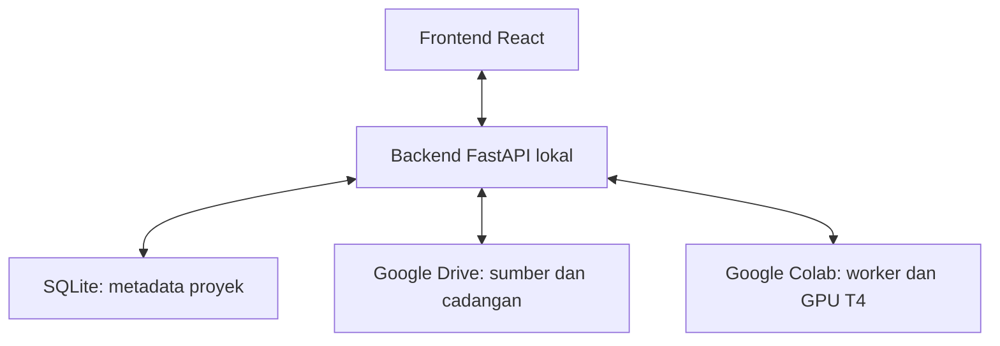

# Chanthecno Training Hub

**Latih model AI sendiri.**

**Status: Rilis Awal — dalam pengembangan aktif.**

**Chanthecno Training Hub (CTH)** adalah produk pertama **ChanThecno**, yang dikembangkan untuk membantu pengguna menyiapkan dataset, mengelola proyek, dan menjalankan pelatihan model melalui satu antarmuka web lokal.

CTH dirancang untuk menghubungkan **Google Drive sebagai penyimpanan proyek** dan **Google Colab sebagai tempat komputasi GPU**. Frontend dan backend berjalan di komputer pengguna, sedangkan pekerjaan pelatihan ditujukan untuk berjalan di Colab. Proyek ini dikembangkan secara terbuka dengan arah sebagai platform open source.

Pada tahap awal, pendekatan pelatihan yang dibuat adalah **fine-tuning model dasar Qwen**, bukan membangun seluruh model dari nol. Pengguna dapat memberi nama model hasil proyeknya, tetapi model dasar tetap memiliki pengetahuan dan ketentuan penggunaannya sendiri.

> **Catatan peluncuran:** sebagian fungsi pengelolaan proyek, koneksi Google Drive, dan akses GPU sudah berhasil diuji. Jalur training dari frontend masih dalam perbaikan dan belum terkonfirmasi menyelesaikan pelatihan penuh. API, struktur berkas, dan perilaku aplikasi masih dapat berubah. Rilis ini belum ditujukan sebagai layanan produksi atau layanan publik untuk banyak pengguna.

## Tujuan proyek

CTH dibangun untuk membuat alur pengembangan model lebih mudah dipahami dan dikendalikan:

- Menyiapkan data teks untuk proyek tertentu.
- Menyimpan metadata proyek dan mengatur folder Google Drive.
- Menghubungkan runtime Colab dari antarmuka CTH.
- Menjalankan kode training yang dipelihara di repositori.
- Memantau progres, checkpoint, dan hasil pelatihan.
- Mengembangkan pengujian model melalui percakapan web.
- Menyiapkan ekspor GGUF dan, pada tahap berikutnya, deployment ke VPS.

Tujuan tersebut merupakan arah pengembangan. Status setiap bagian dijelaskan di bawah agar fitur yang direncanakan tidak dianggap sudah selesai.

## Status fitur

### Sudah berfungsi dan telah diuji

| Fitur | Kondisi saat ini |
| --- | --- |
| Backend FastAPI | Server lokal dan dokumentasi Swagger berhasil dijalankan. |
| Penyimpanan metadata | SQLite digunakan untuk menyimpan proyek. |
| Pembuatan proyek | Endpoint pembuatan proyek telah berhasil digunakan. |
| Daftar proyek | Frontend terhubung ke daftar proyek backend. |
| Pemilihan proyek | Proyek aktif dapat dipilih melalui antarmuka. |
| OAuth Google Drive | Otorisasi dan pemeriksaan akses Drive berhasil dilakukan. |
| Folder proyek Drive | Folder utama serta subfolder `datasets`, `notebooks`, `training_results`, dan `models` berhasil dibuat. |
| Upload berkas Drive | Upload nyata telah diuji dengan verifikasi ukuran dan checksum. TXT untuk percobaan training juga telah tersimpan. |
| Akses Colab | Pemeriksaan API dan permintaan runtime telah berhasil dilakukan. |
| Alokasi T4 | Runtime T4 Standard berhasil dibuat melalui API. |
| Eksekusi GPU | Pengujian `nvidia-smi` melalui koneksi WebSocket berhasil mendeteksi Tesla T4 dengan memori 15.360 MiB. Ini pengujian GPU, bukan bukti training selesai. |
| Antarmuka modular | Sidebar, header, konteks workspace, dan halaman per fitur sudah dibuat. |
| Sumber TXT lokal | TXT dapat dibaca dan dipratinjau dalam memori tab. |
| Daftar URL | Alamat HTTP/HTTPS dapat dicatat sebagai sumber; isi situs belum diambil. |
| Visual jaringan saraf | Komponen baru berisi 150 kotak bercabang dua, otak kecil di pusat, dan aliran cahaya dari kotak luar menuju otak. Visual dan arah alirannya telah diuji di browser. |
| Launcher lokal | `chanthecno-hub` telah berhasil membuka antarmuka serta menjalankan layanan lokal pada lingkungan pengembangan. |

### Kode sudah dibuat, integrasi belum sepenuhnya terverifikasi

| Fitur | Kondisi saat ini |
| --- | --- |
| Mulai training dari web | Permintaan, penyimpanan TXT, pengiriman paket worker, dan peluncuran worker telah dijalankan. Percobaan terakhir masih gagal pada persiapan environment; belum ada konfirmasi pelatihan selesai. |
| Fine-tuning Qwen | Skrip LoRA untuk `Qwen/Qwen2.5-0.5B-Instruct` sudah dibuat, termasuk validasi data, evaluasi, dan checkpoint. Belum dinyatakan lolos pengujian GPU penuh melalui CTH. |
| Pelaporan progres | Kode status, step, epoch, dan loss sudah tersedia. Keandalannya masih perlu diperbaiki bersama alur training. |
| Hentikan training | Mekanisme stop kooperatif meminta worker berhenti setelah langkah optimizer dan menyimpan checkpoint. Alur nyata perlu diuji setelah training berjalan. |
| Stop & Simpan | Kode pencadangan workspace, upload Drive, verifikasi, dan penghentian runtime sudah dibuat. Pengujian simulasi lolos; pencadangan checkpoint model nyata sampai runtime berhenti belum dikonfirmasi berhasil. |
| Resume checkpoint | Skrip training memiliki pemeriksaan checkpoint dan kesesuaian konfigurasi untuk resume. Belum tersedia sebagai alur pemulihan otomatis pada web. |
| Jawaban berbasis sumber | Skrip pencarian/jawaban berbasis data proyek sudah disiapkan; belum dihubungkan ke chat model pada frontend. |
| Ekspor GGUF | Skrip merge adapter, konversi, dan kuantisasi telah dibuat. Ekspor model hasil CTH belum diuji penuh dan belum terhubung ke tombol web. |

### Masih berupa tampilan atau demonstrasi

| Halaman atau elemen | Batas saat ini |
| --- | --- |
| Model Testing | Tampilan percakapan dan efek balasan bertahap tersedia; belum menjalankan inferensi model asli. |
| Tombol unduh model | Antarmuka ekspor belum menghasilkan model GGUF dari web. |
| Deployments | Halaman awal tersedia; belum menghubungkan atau melakukan deployment ke VPS. |
| Training Performance | Belum menjadi grafik metrik training nyata yang terintegrasi. |
| Statistik dataset dan model | Bagian yang belum terhubung tidak boleh dianggap sebagai jumlah hasil training sebenarnya. |
| Pratinjau animasi saraf | Demonstrasi visual, bukan pekerjaan training. Animasi aktif saja tidak membuktikan GPU atau optimizer berjalan. |

### Belum dibuat atau belum selesai

- Pengambilan dan pembersihan isi situs dari URL.
- Pengelolaan dataset persisten yang dimuat kembali otomatis setelah browser ditutup.
- Sinkronisasi checkpoint berkala ke Drive selama training.
- Pemulihan otomatis arsip Drive ke runtime Colab baru.
- Pengujian percakapan dengan model hasil training melalui frontend.
- Alur ekspor GGUF dan unduhan hasil melalui frontend.
- Integrasi deployment VPS.
- Autentikasi aplikasi dan isolasi data untuk banyak pengguna.
- Pemulihan pekerjaan yang terputus secara andal tanpa perbaikan manual.
- Penyelesaian dan pengujian penghapusan proyek beserta aturan penghapusan data Drive.

## Arsitektur

Frontend React menampilkan kontrol dan status. Backend FastAPI menangani metadata, otorisasi Google, validasi permintaan, transfer berkas, serta komunikasi dengan runtime. Token Google tidak dikirim ke frontend.



Kode worker berada di folder `training/` dan dipelihara melalui repositori. Pengguna memilih proyek, data, nama model, dan parameter yang disediakan antarmuka. Browser tidak menyediakan editor kode Python bebas untuk dikirim ke runtime.

Repositori: [Chanthecno-Training-Hub](https://github.com/candripanjaitan16/Chanthecno-Training-Hub).

## Teknologi

| Bagian | Teknologi |
| --- | --- |
| Frontend | React, Vite, Tailwind CSS, dan stylesheet komponen CTH |
| Visual saraf | Canvas 2D, tanpa dependensi visual tambahan |
| Backend | Python, FastAPI, Pydantic |
| Metadata | SQLite |
| Otorisasi Google | OAuth dan library Google untuk Python |
| Penyimpanan eksternal | Google Drive API |
| Runtime komputasi | Colab API, Jupyter, WebSocket |
| Pelatihan | PyTorch, Transformers, PEFT/LoRA, Accelerate |
| Model dasar awal | Qwen2.5-0.5B-Instruct |
| Ekspor yang disiapkan | llama.cpp dan GGUF |

## Struktur utama

| Lokasi | Peran |
| --- | --- |
| `chanthecno-hub` | Launcher aplikasi lokal. |
| `backend/app/main.py` | Aplikasi FastAPI dan pendaftaran router. |
| `backend/app/database.py` | Koneksi serta inisialisasi SQLite. |
| `backend/app/projects.py` | Endpoint metadata dan pembuatan proyek. |
| `backend/app/drive_auth.py` | Otorisasi dan pemeriksaan akses Google. |
| `backend/app/drive_manager.py` | Pembuatan struktur folder Drive. |
| `backend/app/drive_storage.py` | Upload dan verifikasi berkas. |
| `backend/app/colab.py` | Koneksi, alokasi, dan pemeriksaan runtime. |
| `backend/app/colab_bridge.py` | Komunikasi kontrol dengan Jupyter/Colab. |
| `backend/app/training_jobs.py` | Pengiriman dan pemantauan pekerjaan training. |
| `backend/app/colab_stop.py` | Alur Stop & Simpan. |
| `backend/app/colab_snapshot.py` | Pembuatan dan pemeriksaan arsip workspace. |
| `backend/app/colab_gpu_check.py` | Pemeriksaan GPU di dalam runtime. |
| `frontend/src/pages/` | Overview, Datasets, Training Workspace, Model Testing, Deployments, Google Drive, dan Colab Connection. |
| `frontend/src/components/` | Sidebar, header, ikon, komponen UI, dan NeuralCanvas. |
| `frontend/src/context/WorkspaceContext.jsx` | Pemilihan proyek dan sumber lokal per proyek. |
| `frontend/src/services/api.js` | Komunikasi frontend dengan backend. |
| `training/web_worker.py` | Persiapan environment dan peluncuran training di Colab. |
| `training/train.py` | Fine-tuning, status, evaluasi, dan checkpoint. |
| `training/data.py` | Persiapan serta validasi dataset. |
| `training/common.py` | Konfigurasi bersama, pemeriksaan GPU, lock, dan utilitas berkas. |
| `training/source_answer.py` | Fondasi jawaban berbasis sumber. |
| `training/export_gguf.py` | Fondasi ekspor hasil model ke GGUF. |
| `requirements-training.txt` | Dependensi worker training untuk runtime, bukan untuk launcher lokal. |

Direktori lokal `backend/workspace/` dan berkas status runtime merupakan catatan pekerjaan. Keberadaannya bukan bukti model sudah dilatih atau cadangan Drive berhasil dibuat.

## Menjalankan lingkungan pengembangan

### Prasyarat

- Python dengan dukungan `venv` dan pip, sesuai dependensi backend.
- Node.js dan npm yang sesuai dengan konfigurasi frontend.
- Koneksi internet untuk OAuth, Google API, transfer data, serta unduhan model dan dependensi.
- Proyek Google Cloud dengan konfigurasi OAuth dan API yang diperlukan.
- Akun Google dengan akses Drive dan kelayakan runtime Colab yang diminta.

Backend lokal pernah berjalan menggunakan Python 3.10.12. Library Google telah menampilkan peringatan dukungan versi tersebut; peningkatan versi Python perlu diuji terpisah dari perbaikan training.

### Menyiapkan dependensi lokal

Dari folder utama repositori:

```bash
python3 -m venv backend/.venv
backend/.venv/bin/python -m pip install -r backend/requirements.txt
npm --prefix frontend ci
```

Jangan membuat ulang environment yang sudah berfungsi hanya untuk memperbaiki error worker di Colab. Jangan memasang seluruh dependensi training pada laptop sebagai langkah menjalankan dashboard.

### Konfigurasi Google

Konfigurasikan OAuth dan akses API melalui backend. Pada lingkungan pengembangan saat ini, `credentials.json`, `token.json`, dan `token_colab.json` berada di folder backend dan tidak termasuk berkas publik repositori.

Otorisasi Drive dan Colab merupakan akses yang berbeda. Drive yang terhubung tidak otomatis berarti runtime Colab sudah tersedia, GPU dapat menjalankan kode, atau model siap diuji.

Jangan menyalin token milik orang lain. Instalasi baru harus melakukan otorisasi menggunakan akun dan konfigurasi Google-nya sendiri.

### Menjalankan aplikasi

Dari folder utama proyek:

```bash
chanthecno-hub
```

Alamat pengembangan:

| Layanan | Alamat |
| --- | --- |
| Frontend | `http://localhost:5173` |
| Backend | `http://127.0.0.1:8000` |
| Swagger | `http://127.0.0.1:8000/docs` |

Gunakan origin frontend yang diizinkan konfigurasi CORS. Jangan menjalankan launcher kedua ketika server yang sama masih aktif.

Untuk menyalakan backend secara terpisah, jalankan dari folder `backend`:

```bash
./.venv/bin/python -m uvicorn app.main:app --host 127.0.0.1 --port 8000
```

Biarkan terminal server tetap berjalan. Gunakan terminal lain untuk membaca status atau log.

## Alur penggunaan yang sedang dikembangkan

1. Buat atau pilih proyek melalui Google Drive.
2. Tambahkan TXT milik proyek melalui Datasets. URL baru dicatat, belum diambil isinya.
3. Hubungkan T4 melalui Colab Connection dan pastikan runtime terkait proyek yang benar.
4. Buka Training Workspace, pilih nama model serta epoch, lalu kirim permintaan training sekali.
5. Backend menyimpan TXT ke Drive, memverifikasi sumber, dan mengirim paket worker serta dataset ke Colab.
6. Worker menyiapkan environment, memeriksa persyaratan GPU, dan mencoba menjalankan training.
7. Pantau status, step, epoch, dan loss. Permintaan diterima bukan bukti training sudah berjalan atau selesai.
8. Setelah pekerjaan selesai atau dihentikan dengan benar, gunakan Stop & Simpan untuk meminta pencadangan workspace ke Drive sebelum mematikan runtime.

Alur tersebut belum dinyatakan selesai diuji dari awal sampai akhir. Selama perbaikan, jangan mengandalkan satu-satunya salinan data pada penyimpanan sementara Colab.

## Data, model, dan checkpoint

### Sumber data

TXT diperiksa sebagai teks UTF-8 dan ditolak jika kosong atau mengandung NUL. Frontend memiliki pemeriksaan sumber duplikat dan validasi dasar URL. Pengamanan backend tetap diperlukan; atribut input file di browser bukan pengganti validasi server.

Sumber lokal berada dalam memori tab hingga dikirim melalui alur penyimpanan. Menutup atau memuat ulang halaman dapat menghilangkan pratinjau yang belum disimpan. Pilihan proyek yang diingat browser tidak berarti isi dataset ikut tersimpan permanen.

Worker juga memiliki dukungan data JSONL terstruktur pada tingkat skrip. Ini belum berarti halaman upload web telah mendukung seluruh format tersebut.

### Fine-tuning

Konfigurasi awal menggunakan LoRA pada Qwen 0.5B. Skrip memisahkan data train dan validasi, merekam konfigurasi run, dan memeriksa kecocokan data/kode sebelum resume.

Fine-tuning teks tidak menjamin jawaban hanya berasal dari dataset proyek. Pengetahuan model dasar tetap ada. Untuk jawaban yang wajib terikat sumber, pencarian konteks, aturan penolakan, dan pengujian jawaban masih harus diintegrasikan dan dievaluasi.

### Dua jenis penghentian

| Tindakan | Tujuan |
| --- | --- |
| Hentikan training | Meminta worker berhenti secara kooperatif dan menyimpan checkpoint ketika proses memungkinkan. Tidak mematikan T4. |
| Stop & Simpan | Meminta worker berhenti, membuat arsip workspace, mengunggah serta memverifikasinya di Drive, lalu meminta runtime berhenti. |

Checkpoint di disk Colab belum menjadi cadangan Drive. Snapshot menyimpan berkas dalam cakupan workspace proyek, bukan variabel RAM, seluruh isi runtime, atau cache di luar cakupan tersebut. Stop & Simpan tidak boleh melaporkan berhasil hanya karena sebuah permintaan telah diterima.

### GGUF

Format ekspor yang direncanakan adalah **GGUF**, bukan GFF atau GUFF. Skrip ekspor disiapkan untuk menggabungkan adapter dengan model dasar dan menghasilkan F16, Q8_0, atau Q4_K_M menggunakan alat konversi.

Mengganti ekstensi berkas bukan konversi model. Arsip cadangan workspace juga bukan model GGUF. Ekspor tetap memerlukan hasil training lengkap, verifikasi keluaran, serta pengujian terpisah.

## Keterbatasan dan masalah yang diketahui

- Pemeriksaan runtime dapat menerima `409 Conflict` selama proses persiapan memegang pengunci. Pemisahan kontrol pekerjaan dan pembacaan status masih perlu diperbaiki.
- Beberapa pesan kegagalan masih umum sehingga log worker perlu dibaca untuk menemukan penyebab sebenarnya.
- Pesan “Permintaan diterima” dapat tetap terlihat walaupun status pekerjaan telah berubah menjadi gagal. Status akhir pekerjaan harus menjadi acuan.
- Kegagalan `ensurepip` ditemukan pada environment Colab. Worker sudah diperbaiki agar membuat environment dengan `--without-pip` dan menghilangkan blok pembuatan environment yang terduplikasi. Perbaikan sintaks telah diperiksa, tetapi belum ada konfirmasi run training selesai setelah perbaikan terakhir.
- Dependensi lama worker dan paket bawaan Colab dapat memiliki perbedaan versi. Kompatibilitas perlu diuji, bukan diselesaikan dengan menghapus atau memasang ulang semuanya.
- Alokasi T4 melalui API belum membuktikan CUDA, model, dan optimizer siap. Pemeriksaan eksekusi di dalam runtime tetap diperlukan.
- Sesi Colab dan ketersediaan GPU tidak permanen. Aplikasi tidak menjanjikan GPU menyala terus dan tidak beralih ke CPU secara diam-diam.
- Google Drive memiliki batas penyimpanan, izin, serta kuota API. Kegagalan jaringan atau kuota dapat menggagalkan upload maupun verifikasi.
- Sinkronisasi checkpoint berkala ke Drive dan pemulihan otomatis sesi baru belum tersedia.
- Membuat folder Drive dan menyimpan metadata SQLite bukan transaksi tunggal; kegagalan di tengah proses perlu ditangani agar tidak meninggalkan folder atau metadata yang tidak konsisten.
- Memilih proyek lama belum otomatis memulihkan model dari arsip ke runtime baru.

## Keamanan dan privasi

CTH saat ini adalah aplikasi lokal satu akun. Pemisahan sumber menurut proyek bukan isolasi tenant yang siap melayani banyak pengguna.

- Simpan token, OAuth credentials, dan informasi koneksi runtime di backend.
- Jangan menaruh rahasia pada frontend, variabel `VITE_*`, repositori publik, dataset, log publik, atau arsip model.
- Pastikan `.gitignore` mencakup token, credentials, environment, database lokal, serta catatan pekerjaan yang tidak untuk dipublikasikan. `.gitignore` bukan kontrol akses bagi program atau agen yang dapat membaca folder.
- Jangan mengubah folder Drive menjadi publik hanya agar integrasi bekerja. Gunakan izin yang sesuai dan verifikasi lokasi upload.
- Jangan membuka backend pengembangan ke internet sebelum autentikasi aplikasi, otorisasi, isolasi pengguna, dan pembatasan permintaan diselesaikan.
- Gunakan data yang dimiliki atau diizinkan untuk digunakan. Pencatatan URL belum merupakan izin mengambil atau melatih seluruh isi situs.
- Jika rahasia terpublikasi, cabut akses terkait dan lakukan otorisasi ulang. Menghapus salinan lokal saja tidak mencabut akses yang telah bocor.

## Pengujian

Pengujian yang telah dilakukan mencakup pemeriksaan sintaks, build frontend, simulasi endpoint dan pekerjaan, checksum arsip, ekstraksi paket, penolakan path berbahaya, penanganan upload gagal, serta pengujian visual browser.

Pengujian nyata Google Drive dan `nvidia-smi` di T4 juga telah berhasil. Pengujian simulasi tersebut tidak menggantikan pengujian training penuh, penghentian setelah checkpoint nyata, pemulihan cadangan, maupun ekspor model.

Status keberhasilan model baru boleh dinyatakan setelah pekerjaan selesai, artefaknya terverifikasi, dan hasilnya diuji menggunakan data evaluasi yang sesuai.

## Arah pengembangan berikutnya

1. Menuntaskan persiapan worker dan satu run training nyata di T4.
2. Memperbaiki penguncian, polling, pesan error, dan pemulihan pekerjaan yang terputus.
3. Membuktikan stop kooperatif dan pencadangan checkpoint ke Drive pada run nyata.
4. Menambahkan pemulihan arsip dan sinkronisasi checkpoint berkala.
5. Menghubungkan pengujian model dan jawaban berbasis sumber ke frontend.
6. Mengintegrasikan ekspor serta unduhan GGUF.
7. Menyelesaikan autentikasi, otorisasi, dan isolasi data pengguna.
8. Menambahkan deployment VPS setelah alur lokal stabil.

## Catatan kreator

Proyek ini diinisiasi berdasarkan kebutuhan nyata. Konsep, struktur, tujuan produk, dan arah pengembangannya dirancang oleh **Candri Panjaitan** dengan bantuan AI untuk penyusunan kode dasarnya.

Menurut perkiraan kreator, pada tahap awal sekitar **90% kode backend masih merupakan fondasi awal hasil generate AI**. Kode tersebut sedang diperiksa, dipelajari, diperbaiki, dan diuji secara bertahap.

Penggunaan AI tidak dianggap sebagai jaminan bahwa kode sudah benar, aman, atau siap produksi. CTH juga menjadi bagian dari proses belajar membangun sistem yang dapat dipahami dan dipelihara, bukan sekadar menghasilkan kode.

## Kontribusi dan lisensi

Masukan, laporan bug, perbaikan dokumentasi, dan kontribusi kode dapat diajukan melalui repositori. Sertakan langkah reproduksi, status pekerjaan, serta log yang sudah dibersihkan dari token, credentials, dan data pribadi.

Lisensi proyek perlu dinyatakan melalui berkas `LICENSE` repositori. README ini tidak menetapkan jenis lisensi yang belum dikonfirmasi. Model dasar, library, dataset, dan alat pihak ketiga tetap mengikuti ketentuan masing-masing.

---

**Dikembangkan oleh Candri Panjaitan untuk ChanThecno.**

**Status dokumentasi: 1 November 2026 — Rilis Awal.**
